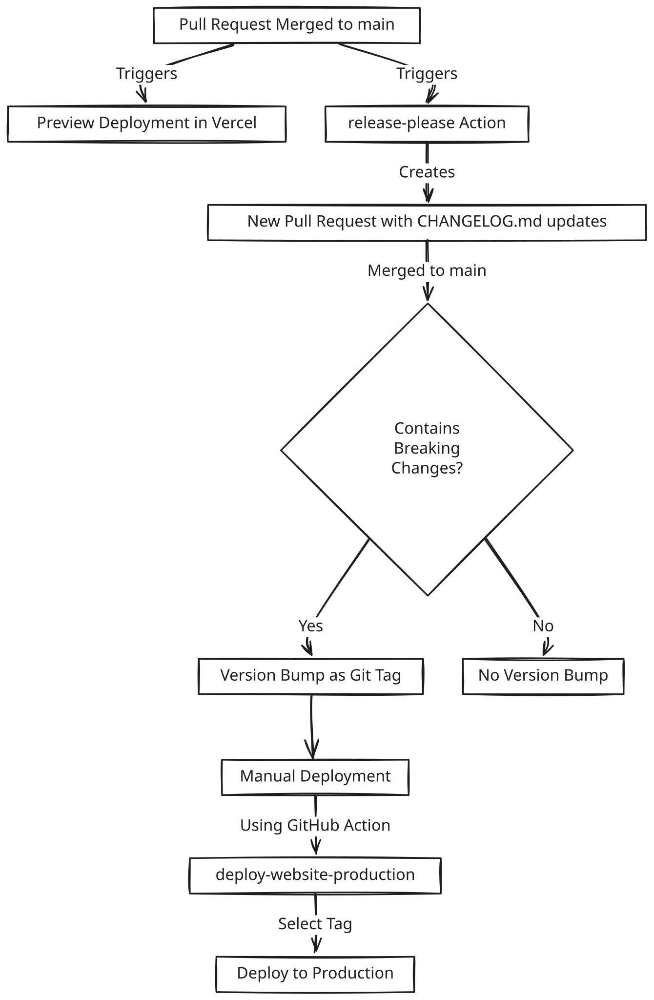

# Deployment

We are using conventional commits and semantic versioning for the project. The deployment process is as follows:

- When a pull request is merged into `main` triggers a preview deployment in Vercel and a new pull request created by [`release-please`](https://github.com/googleapis/release-please-action/tree/v4/) GitHub Action with the changes documented in the [`CHANGELOG.md`](./CHANGELOG.md) file
- When the pull request with the changes in the `CHANGELOG.md` file is merged into `main` and has breaking changes, it triggers a version bump as a git tag.
- Then, we can manually deploy the new version to production by using the GitHub Action [`deploy-website-production`](./.github/workflows/deploy-website-production.yml) and selecting the tag to deploy.

## Content revalidation

Every Contentful read is cached for up to an hour (`cacheLife('hours')` in
`website/src/graphql/client.ts`) and tagged `contentful`. A Contentful webhook
calls `POST https://www.nr2f1.org/api/revalidate` on every publish and
unpublish, so editors see their change on the next request instead of waiting
for the hour to pass. The route answers 401 when the secret header does not
match and 500 when the variable is missing.

One-time setup:

1. Vercel → Project → Settings → Environment Variables: add
   `CONTENTFUL_REVALIDATE_SECRET` (a long random string) for Production and
   Preview, then redeploy.
2. Contentful → Settings → Webhooks → Add webhook: URL
   `https://www.nr2f1.org/api/revalidate`, method POST, triggers Entry
   publish/unpublish/delete and Asset publish/unpublish/delete, and a custom
   header `x-revalidate-secret` with the same value (tick "secret header").
3. Publish a small change and reload the page: it should show on the first
   reload. A 401 in Contentful's webhook log means the two values differ.
